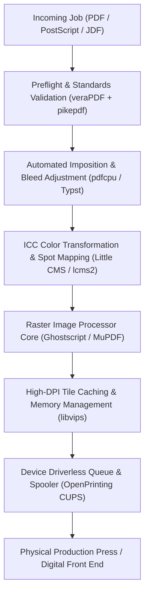

# 🖨️ Awesome Embedded Print Workflow Engine

<p align="center">
  
</p>

<p align="center">
  <a href="https://github.com/ishandutta2007/Awesome-Awesome-Awesome"></a><a href="https://discord.gg/jc4xtF58Ve"></a>
  <a href="https://github.com/ishandutta2007/Awesome-Embedded-Print-Workflow-Engine/stargazers"></a>
  <a href="https://github.com/ishandutta2007/Awesome-Embedded-Print-Workflow-Engine/network/members"></a>
  <a href="https://github.com/ishandutta2007/Awesome-Embedded-Print-Workflow-Engine/issues"></a>
  <a href="https://github.com/ishandutta2007/Awesome-Embedded-Print-Workflow-Engine/blob/main/LICENSE"></a>
  <a href="https://github.com/ishandutta2007/Awesome-Embedded-Print-Workflow-Engine"></a>
  <a href="https://github.com/ishandutta2007"></a>
</p>

---

### 📖 Executive Summary & Scope

A curated directory of **Embedded Print Workflow Engines**, **Raster Image Processors (RIP)**, **Color Management Systems (CMS)**, and **Automated Prepress Pipelines**. 

These systems convert PDF, PostScript, and vector graphics into high-density bitmap rasters for digital production presses, wide-format inkjet plotters, industrial textile/ceramic printers, and embedded multifunction peripherals (MFPs). Key responsibilities include ICC color profiling, spot-color matching (Pantone/HKS), imposition layout, ganging, nesting, cutting-path generation, and JDF/XJDF job-ticket communication.

---

## 📑 Table of Contents

- [📊 Sector Overview & Market Dynamics](#-sector-overview--market-dynamics)
- [💼 Commercial & SaaS Print Workflow Engines](#-commercial--saas-print-workflow-engines)
- [🛠️ Open-Source Engines & Prepress Toolkits](#️-open-source-engines--prepress-toolkits)
- [🧩 Architectural Blueprint: Custom Sovereign RIP Pipeline](#-architectural-blueprint-custom-sovereign-rip-pipeline)
- [🤝 How to Contribute](#-how-to-contribute)
- [⭐ Star History](#-star-history)
- [💖 Support & Sponsorship](#-support--sponsorship)
- [📜 License & Disclaimer](#-license--disclaimer)

---

## 📊 Sector Overview & Market Dynamics

The global **Raster Image Processor (RIP) software and digital print workflow automation** market is estimated at **$3.2 billion to $4.5 billion**, driving a broader digital printing equipment and consumables ecosystem valued at **$36 billion to $44 billion** (projected to reach over $75 billion by 2032 with a 6.8% CAGR). 

Market dynamics demonstrate a **bifurcated, moderately concentrated structure at the foundational rasterizer core**: an oligopoly of foundational RIP IP engines—principally the *Adobe Embedded Print Engine (AEPE / APPE)*, *Hybrid Software's Harlequin RIP*, and *Fiery DFE*—powers the vast majority of OEM commercial and industrial printing machinery worldwide. Conversely, the market remains **moderately fragmented at the front-end application and workflow tier**, where specialized software providers cater to distinct, demanding verticals such as wide-format signage, textile dye-sublimation, corrugated packaging, and ceramic decoration.

---

## 💼 Commercial & SaaS Print Workflow Engines

The table below lists the premier commercial and SaaS embedded print workflow engines, sorted in **descending order by company scale, valuation, and revenue**.

| Platform / Product | Company Scale / Valuation / Revenue | Pricing (Starting Tier) | Free Tier / Trial Limits | Core Architectural Strengths |
| :--- | :--- | :--- | :--- | :--- |
| **[Adobe Embedded Print Engine (AEPE)](https://www.adobe.com/products/adobe-embedded-print-engine.html)** | 🏢 **Market Cap:** ~$100B–$146B<br>💰 **Annual Revenue:** ~$23.8B *(Adobe Inc. - NASDAQ: ADBE)* | **~$5.00 – $15.00 / device** OEM unit royalty; or **~$10,000 / year** enterprise developer integration license | **90-day OEM Developer Evaluation** agreement with full test rasterizer SDK, technical support, and sample test suites | Native PDF 2.0, PostScript 3, and PCL 6 interpreter; ultra-low RAM footprint designed for embedded printer controller ASICs and cloud DFEs. |
| **[Caldera RIP](https://www.caldera.com/)** | 🏢 **Parent Market Cap:** ~$25.0B<br>💰 **Parent Revenue:** ~$8.4B *(Dover Corp. - NYSE: DOV)*<br>*(Caldera: ~$30M ARR)* | **$1,395 / year** (approx. **$116 / month** billed annually) for *VisualRIP Essentials* | **15-day full-featured free trial** / evaluation license with device driver testing and cut-path generation | High-throughput wide-format RIP with Adobe PDF Print Engine integration, InkPerformer ink reduction (up to 30%), and ContourNesting. |
| **[ColorGATE Digital Output](https://www.colorgate.com/)** | 🏢 **Parent Market Cap:** ~$5.5B<br>💰 **Parent Revenue:** ~$15.5B *(Ricoh Co., Ltd. - Tokyo: 7752)*<br>*(ColorGATE: ~$15M ARR)* | **€990 / year** subscription or **€1,800 (~$1,950)** perpetual for *Productionserver Select* entry tier | **30-day evaluation trial license** provided through authorized Ricoh/ColorGATE dealer networks | Modular RIP & ICC profiling (Productionserver, Filmgate) utilizing APPE 7.1 with specialized industrial screening for packaging & textiles. |
| **[EFI Fiery](https://www.efi.com/)** | 🏢 **Valuation:** $591M Acquisition Valuation *(Seiko Epson Corp.)*<br>💰 **Annual Revenue:** ~$260M–$280M *(Parent Epson: ~$9.1B)* | **$2,100** list price for *Fiery XF Production* server license; *Command WorkStation* client is free | **30-day free trial** for *Fiery XF*, *Fiery JobFlow*, and *ColorGuard*; *Command WorkStation* client free forever for up to 10 connected servers | Industry-benchmark Digital Front End (DFE) with FAST RIP acceleration, JDF/JMF compliance, spot-color matching, and variable data printing (VDP). |
| **[Global Graphics Harlequin RIP](https://www.globalgraphics.com/)** | 🏢 **Market Cap:** ~$136M USD<br>💰 **Annual Revenue:** ~€75M (~$82M USD) *(Hybrid Software Group - Euronext: HYSG)* | **$2,995** for *Navigator RIP* workstation bundle; **~$5,000 / year** for OEM Harlequin Core SDK licenses | **30-day evaluation license** and live test proofing environment through Xitron and Hybrid Software certified channels | Lightning-fast native RIP core for OEM DFEs, PDF/X, PDF/VT variable data processing, and Harlequin VariData multi-threaded caching. |
| **[ONYX Graphics](https://onyxgfx.com/)** | 🏢 **Ownership:** Privately held *(Fortis Solutions Group)*<br>💰 **Estimated Revenue:** ~$25M–$50M | **$52.00 / month** for *ONYX Go Lite*; **$104.95 / month** for *ONYX Go Plus* (no contract, auto-renewal) | **15-day free trial** (no credit card required) with full functionality for ONYX Go; **30-day free trial** for *ONYX TruFit* nesting | Production RIP suite supporting 2,000+ printers and cutters, ICC color engine, multi-layer white/varnish generation, and automated tiling. |
| **[SAi Flexi](https://www.thinksai.com/)** | 🏢 **Ownership:** Privately held *(SA International)*<br>💰 **Estimated Revenue:** ~$20M–$35M | **$33.99 / month** (billed annually at $407.88/yr) for *Flexi Design*; **$70.99 / month** for *Flexi Complete* with 64-bit RIP | **7-day full access free trial** for *Flexi Complete* and *Flexi Design* with automated transition to plan unless cancelled | Complete all-in-one signmaking suite with vector design, 64-bit RIP engine, direct vinyl cutting, and support for 7,500+ output devices. |
| **[Wasatch SoftRIP](https://wasatch.com/)** | 🏢 **Ownership:** Privately held *(Wasatch Computer Tech)*<br>💰 **Estimated Revenue:** ~$10M–$25M | **$68.00 / month** on Auto-Pay subscription (or **$795.00 / year** pre-paid annual license) for 2 print units | **30-day evaluation trial** via Wasatch digital coupons or dealer migration path with 2 full active printer units | Robust XML-driven automated hot-folders, specialized Label Edition with rotary die support, and precision dye-sublimation color tables. |
| **[Compose Express RIP](https://compose-system.com/)** | 🏢 **Ownership:** Privately held *(Compose System Limited)*<br>💰 **Estimated Revenue:** ~$8M–$18M | **~$1,850** list price for starter single-RIP license package depending on device driver resolution | **14-day dealer evaluation demo** with watermarked raster output upon partner request | Harlequin-powered PostScript/PDF/XPS RIP supporting up to 9,000 dpi, multi-bit screening (HXM, FM/stochastic), and Computer-to-Plate (CTP) control. |
| **[Ergosoft RIP](https://www.ergosoft.net/)** | 🏢 **Ownership:** Privately held *(Ergosoft AG, Switzerland)*<br>💰 **Estimated Revenue:** ~$5M–$15M | **€1,790 (~$1,940)** perpetual for *Entry Level* (includes 1 entry printer + 1 cutter driver; 1 yr free updates) | **14-day evaluation license** provided upon technical consultation with Ergosoft engineering or local distributor | Swiss-engineered RIP and color engine featuring ColorGPS profiling, 3D Gamut Viewer, and dynamic queue management for high-end textiles. |

---

## 🛠️ Open-Source Engines & Prepress Toolkits

The following verified open-source libraries, rasterizers, and prepress utilities provide the building blocks for sovereign, self-hosted print workflow pipelines. **Sorted in descending order by GitHub stargazers count**:

1. **[Typst](https://github.com/typst/typst)** [](https://github.com/typst/typst/stargazers)  
   *High-performance, markup-based typesetting system and document compiler offering sub-second incremental rendering, programmatic layout calculation, and publication-ready PDF export with custom bleed, crop marks, and imposition hooks.*

2. **[libvips](https://github.com/libvips/libvips)** [](https://github.com/libvips/libvips/stargazers)  
   *Demand-driven, horizontally streaming image processing engine with ultra-low memory requirements. Essential for massive bitmap tile rendering, raster caching, high-DPI scaling, and multi-gigapixel continuous-tone RIP output.*

3. **[PyMuPDF](https://github.com/pymupdf/PyMuPDF)** [](https://github.com/pymupdf/PyMuPDF/stargazers)  
   *Blazing-fast Python bindings for the MuPDF rendering core. Supports direct PDF parsing, high-resolution bitmap rasterization into Pixmaps, color-space conversions (RGB/CMYK/DeviceGray), and geometric transformations.*

4. **[pypdf](https://github.com/py-pdf/pypdf)** [](https://github.com/py-pdf/pypdf/stargazers)  
   *Pure-Python PDF manipulation toolkit capable of splitting, merging, rotating, cropping, page-scaling, and metadata inspection without any native OS dependencies—ideal for lightweight imposition scripts.*

5. **[WeasyPrint](https://github.com/Kozea/WeasyPrint)** [](https://github.com/Kozea/WeasyPrint/stargazers)  
   *Web-to-print document factory converting HTML5 and CSS3 into print-ready PDFs. Features built-in CSS Paged Media support (`@page`), CMYK output intents, crop/bleed registration marks, and ICC color profile attachment.*

6. **[pdfcpu](https://github.com/pdfcpu/pdfcpu)** [](https://github.com/pdfcpu/pdfcpu/stargazers)  
   *Extremely fast Go-based PDF processing library and CLI. Native support for complex N-up imposition, booklet creation, grid arrangement, watermark embedding, page trimming, and structural PDF validation.*

7. **[PDFMiner.six](https://github.com/pdfminer/pdfminer.six)** [](https://github.com/pdfminer/pdfminer.six/stargazers)  
   *Comprehensive PDF analysis tool designed to extract exact physical coordinates of glyphs, font families, bounding boxes, and images for rigorous automated prepress quality control.*

8. **[PDF Arranger](https://github.com/pdfarranger/pdfarranger)** [](https://github.com/pdfarranger/pdfarranger/stargazers)  
   *Interactive GTK/Python GUI application for rearranging, splitting, merging, cropping, and duplex-adjusting PDF pages; provides an intuitive visual verification layer for imposition proofing.*

9. **[QPDF](https://github.com/qpdf/qpdf)** [](https://github.com/qpdf/qpdf/stargazers)  
   *C++ transformation engine and CLI utility for structural PDF inspection, linearization (web-optimization), object encryption/decryption, and stream normalization in automated prepress pipelines.*

10. **[MuPDF](https://github.com/ArtifexSoftware/mupdf)** [](https://github.com/ArtifexSoftware/mupdf/stargazers)  
    *Compact, ultra-fast C rendering engine for PDF, XPS, and OpenXPS; built by Artifex for embedded hardware controllers, mobile print clients, and high-fidelity page rasterization.*

11. **[pikepdf](https://github.com/pikepdf/pikepdf)** [](https://github.com/pikepdf/pikepdf/stargazers)  
    *Python library wrapping QPDF with a pythonic API for low-level PDF object trees. Enables programmatic manipulation of color profiles, PDF/X output intents, metadata dictionaries, and XObjects.*

12. **[CUPS (OpenPrinting)](https://github.com/OpenPrinting/cups)** [](https://github.com/OpenPrinting/cups/stargazers)  
    *The industry-standard open-source printing system for macOS, Linux, and Unix-like operating systems. Manages print queues, spooling, device discovery via IPP Everywhere / mDNS, and filter pipeline dispatching.*

13. **[Little CMS (lcms2)](https://github.com/mm2/Little-CMS)** [](https://github.com/mm2/Little-CMS/stargazers)  
    *The canonical open-source Color Management Module (CMM). Delivers fast, mathematically rigorous color transforms between ICC profiles (CMYK, RGB, Lab, Gray) with black-point compensation and multi-profile proofing.*

14. **[Scribus](https://github.com/scribusproject/scribus)** [](https://github.com/scribusproject/scribus/stargazers)  
    *Full-featured desktop publishing suite with native CMYK color separations, spot color palettes (Open Colour Consortium), PDF/X-1a/PDF/X-3/PDF/X-4 export, and booklet signature generation.*

15. **[pdfjam](https://github.com/pdfjam/pdfjam)** [](https://github.com/pdfjam/pdfjam/stargazers)  
    *Shell script interface leveraging LaTeX `pdfpages` for rapid batch imposition, N-up page consolidation, booklet signature pagination, and custom paper trimming.*

16. **[veraPDF](https://github.com/veraPDF/veraPDF-library)** [](https://github.com/veraPDF/veraPDF-library/stargazers)  
    *The industry-reference, ISO-compliant open-source validator for PDF/A and PDF/X standards. Used by prepress departments to ensure compliance before burning plates or sending jobs to digital presses.*

17. **[Ghostscript / GhostPDL](https://github.com/ArtifexSoftware/ghostpdl)** [](https://github.com/ArtifexSoftware/ghostpdl/stargazers)  
    *The historic foundational open-source PostScript 3 and PDF interpreter/rasterizer. Serves as a full software RIP converting vector geometries, glyphs, and images into device-dependent raster buffers.*

18. **[cups-filters (OpenPrinting)](https://github.com/OpenPrinting/cups-filters)** [](https://github.com/OpenPrinting/cups-filters/stargazers)  
    *Essential conversion filters (`pdftoraster`, `rastertopclx`, `texttopdf`) and driverless printer backends that translate universal PDF print streams into raw device bitstreams on non-Mac platforms.*

19. **[Inkhaven](https://github.com/vulogov/blackInkhaven)** [](https://github.com/vulogov/blackInkhaven/stargazers)  
    *Rust-based terminal prepress and book imposition engine featuring automated signature creation, creep compensation calculations, dynamic spine sizing, and ISBN barcode generation.*

20. **[CIP4 JDFEditor](https://github.com/cip4/JDFEditor)** [](https://github.com/cip4/JDFEditor/stargazers)  
    *Reference application from the CIP4 Consortium to display, edit, and validate Job Definition Format (JDF) documents and JMF messages for automated prepress, press, and postpress communications.*

---

## 🧩 Architectural Blueprint: Custom Sovereign RIP Pipeline

By orchestrating these open-source building blocks, engineering teams can build a fully sovereign, per-seat-license-free digital print workflow engine:



---

## 🤝 How to Contribute

Contributions from print engineers, prepress software developers, and RIP system architects are welcome!

1. 🍴 **Fork the repository** on GitHub.
2. 🌿 **Create a feature branch**:
   ```bash
   git checkout -b feature/add-new-print-engine
   ```
3. 📝 **Add or update entries**: Ensure listings include specific starting tier pricing, explicit free trial limits, verifiable company metrics, and link directly to official documentation.
4. 📬 **Submit a Pull Request** with a concise summary of changes.

---

## ⭐ Star History

[](https://star-history.dera.page/#ishandutta2007/Awesome-Embedded-Print-Workflow-Engine&type=date&legend=top-left)

---

## 💖 Support & Sponsorship

If you find this curated directory of print workflow engines and RIP software valuable for your production print operations, engineering stack, or research, please consider supporting the project:

- ⭐ **Star this repository** to help others discover it.
- 🍴 **Fork and share** with your print automation colleagues.
- ☕ **Buy a coffee or sponsor ongoing maintenance** via the [GitHub Sponsors Dashboard](https://github.com/sponsors/ishandutta2007):

<p align="center">
  <a href="https://github.com/sponsors/ishandutta2007">
    
  </a>
</p>

Thank you for championing sovereign, open, and efficient print workflows!

---

## 📜 License & Disclaimer

- Distributed under the [MIT License](file:///C:/Users/hp/Documents/Projects/Awesome-Embedded-Print-Workflow-Engine/LICENSE).
- All brand names, trademarks, and registered logos (such as Adobe, Fiery, Caldera, Onyx, Harlequin) belong to their respective corporate owners and are used strictly for informational identification purposes.
- Check third-party license terms (e.g., Ghostscript's AGPL / commercial dual licensing) prior to production deployment.

---

<p align="center">
  <b>Built for print shops, OEMs, prepress operators, and print workflow engineers worldwide. 🌐</b>
</p>
